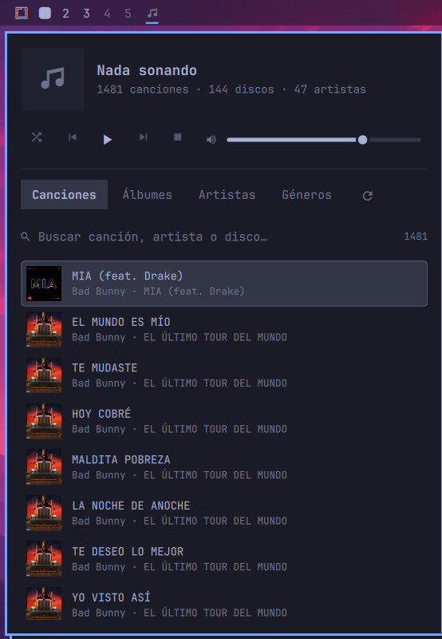

# Mi música — plugin de barra para Omarchy

Reproductor de tu música local (`~/Music`) directamente desde la barra de Omarchy, usando **mpv**.



## Qué hace

- Lee la biblioteca de `~/Music` (mp3, flac, m4a, ogg, opus, wav, aac, wma) con un lector de etiquetas ID3 propio, sin dependencias.
- Pestañas **Canciones, Álbumes, Artistas y Géneros**, con buscador.
- Carátulas por disco, guardadas en `~/.cache/mimusica/portadas/`.
- Controles: aleatorio, anterior, reproducir/pausa, siguiente, detener y volumen.
- Quita de la lista las canciones repetidas (sin borrar archivos).
- Sigue el tema de Omarchy.

## Requisitos

- Omarchy con la barra (Omarchy shell)
- `mpv` y `python3`

```bash
omarchy pkg add mpv
```

## Instalación

```bash
omarchy plugin add https://github.com/luisalgomez111/omarchy-mimusica --enable
```

Para actualizar: `omarchy plugin update io.github.luisalgomez111.mimusica`
Para quitarlo: `omarchy plugin remove io.github.luisalgomez111.mimusica`

Abrir el panel por atajo o script: `omarchy shell io.github.luisalgomez111.mimusica toggle`

---

# My Music — Omarchy bar plugin

Play your local music (`~/Music`) straight from the Omarchy bar, powered by **mpv**.

- Songs, Albums, Artists and Genres tabs with search
- Album art cached in `~/.cache/mimusica/`
- Shuffle, previous, play/pause, next, stop and volume
- Built-in dependency-free ID3 reader; duplicates hidden from the list (files are never deleted)
- Follows the Omarchy theme

**Requirements:** `mpv` and `python3` (`omarchy pkg add mpv`).

**Install:**

```bash
omarchy plugin add https://github.com/luisalgomez111/omarchy-mimusica --enable
```

The interface is in Spanish.

## Licencia / License

GPL-3.0
